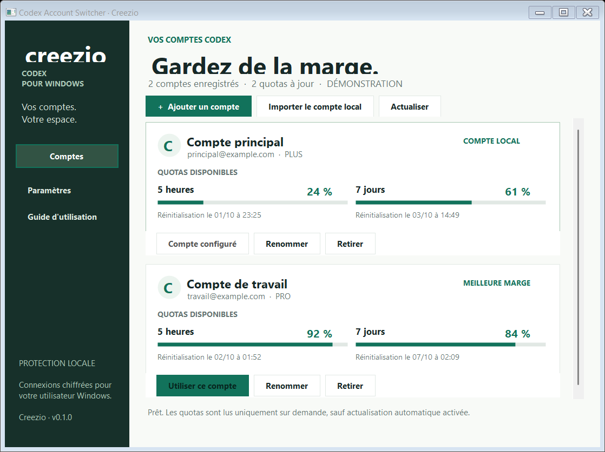
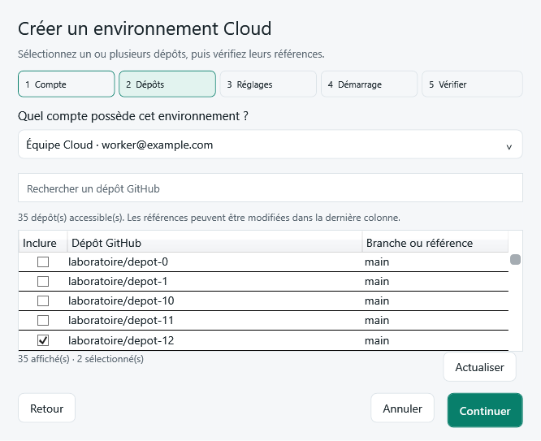
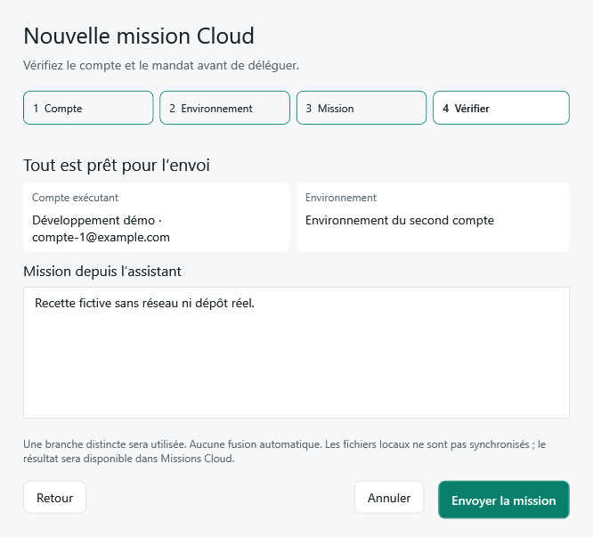
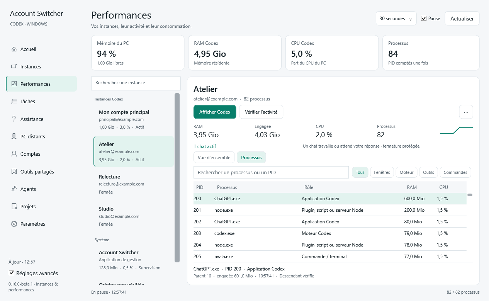
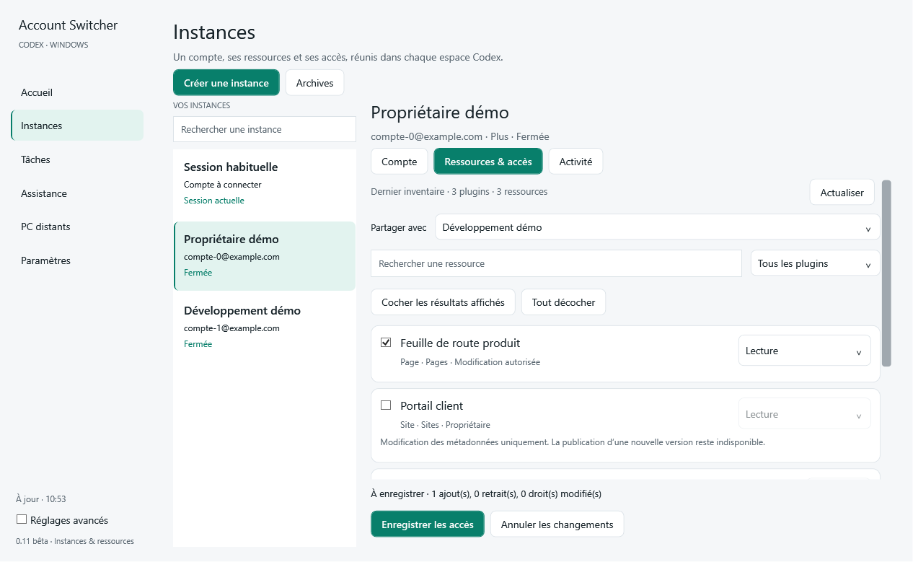
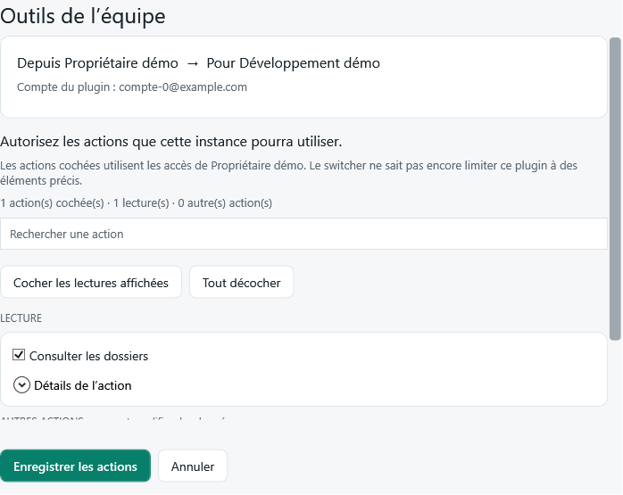
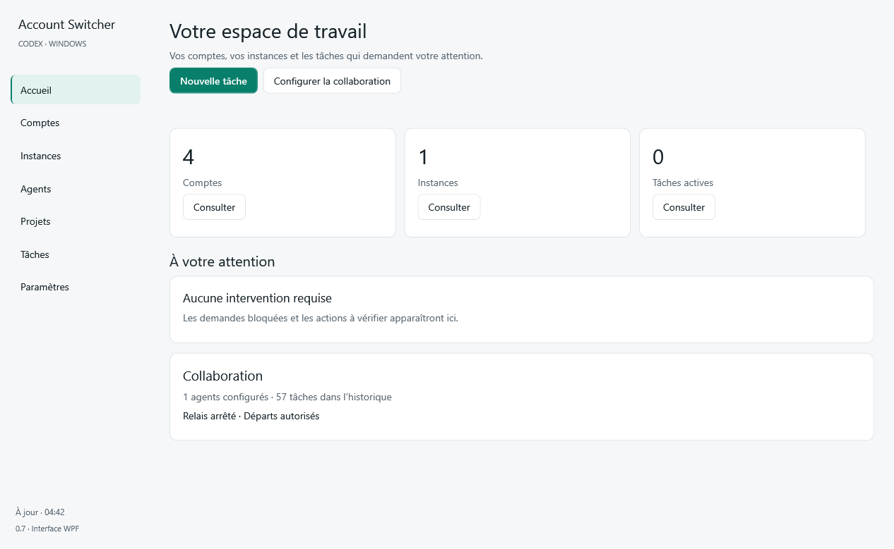
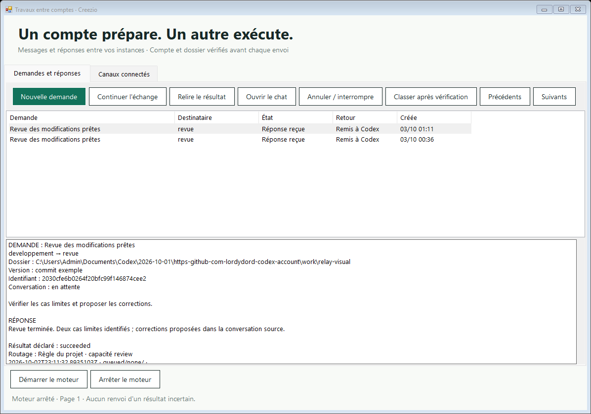
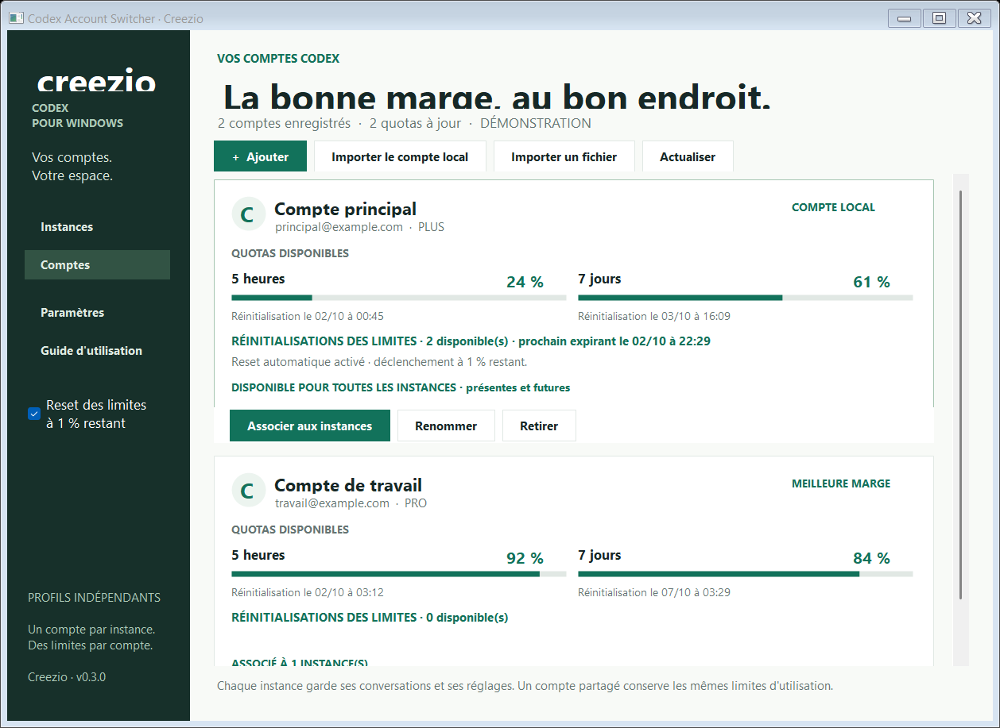

# Codex Account Switcher pour Windows

Une application native pour gérer plusieurs instances Codex en parallèle,
associer vos comptes à vos espaces, suivre leurs limites et transmettre des demandes entre comptes. Développée par **Creezio**.

**Version 0.29.0-beta.7 — Actualisation des ressources sans perdre les changements d’accès, et conservation du dernier catalogue lors d’un échec.** Windows 10/11 x64, interface en
français et livraison portable incluant le runtime .NET 10, sans droits administrateur.

Depuis le Site, un administrateur autorisé peut choisir un compte enregistré ou connecter un nouveau compte avec le lien et le code officiels OpenAI. Le compte réellement connecté est affiché avant confirmation ; le Switcher prépare ensuite son instance, son relais et ses skills sans ouvrir de fenêtre Codex. Les identifiants restent sur le PC. L’administration utilise une clé serveur distincte des clés de messages et une liste locale d’administrateurs. Voir [la configuration et le parcours](docs/WEBHOOKS.md#administration-distante-des-comptes-et-instances).

[Télécharger les versions Windows](https://github.com/creezio/codex-account-switcher-windows/releases)

Dans **Compétences**, consultez les skills préinstallés et leur provenance,
créez ou modifiez vos skills, importez un ZIP et déployez une copie vers une
instance autorisée. Switcher Live propose les mêmes actions dans les ressources
de l’instance. **Planifications** et le panneau **Tâches et objectif** d’une
discussion permettent de préparer un planning Switcher ou de modifier son
objectif natif. Les plannings sont créés en pause ; leur exécution exige que
le PC et Switcher fonctionnent. Les objectifs peuvent aussi être modifiés quand
l’instance Codex est ouverte. Voir [les interfaces et le contrat API](docs/PORTAL-MANAGEMENT.md).

Dans **Webhooks**, créez une entrée vers une instance, un dossier et un chat
nouveau ou existant. Copiez son URL et sa clé dans votre application : le Switcher
reçoit les missions, évite les doublons et expose leur résultat. Cloudflare Tunnel
fournit une adresse HTTPS temporaire ou un domaine stable configuré par vos soins.
Voir [la configuration et les exemples d'appels](docs/WEBHOOKS.md).

Le portail **Switcher Live** propose un composeur avec fichiers et dossiers,
plugins et skills recherchables, modèle, effort et mode Plan lorsqu'il est
disponible. Les mêmes options sont accessibles par webhook, avec des uploads
liés au compte cible et des réessais sans doublon. Les fichiers non envoyés
expirent après 24 heures ; les fichiers envoyés restent disponibles pour leur
historique. Un sélecteur permet de choisir explicitement les permissions natives
de chaque chat ; les nouveaux chats proposent GPT-6.1 Sol · Ultra · Accès complet.
Voir [le contrat complet et les limites du composeur](docs/PORTAL-COMPOSER.md).

Le relais dispose d’un lanceur stable pour remplacer son moteur entre deux appels
après une mise à jour. Le premier chargement du lanceur dans Codex reste distinct
de son installation sur disque ; l’interface affiche la version effectivement
observée. Les anciens processus directs ne sont pas interrompus. Les changements
de documentation compatibles des outils partagés ne demandent plus de refaire
les autorisations. Voir [les règles de compatibilité](docs/TOOL-TUNNEL.md).

Dans **Tâches → Surveillances**, suivez un chat existant et recevez une alerte s’il
attend une intervention, échoue ou s’arrête avant la fin de sa mission. Le moteur
du Switcher lit son état toutes les 60 secondes, sans tâche planifiée Codex ni
appel à un modèle. Les alertes et leur chronologie sont conservées et dédupliquées.
Un avertissement après 15 minutes sans progrès visible reste distinct d’un blocage
confirmé. **Paramètres → Compatibilité Codex** présente les contrôles automatiques
déclenchés après un changement de version, sans ouvrir les instances fermées ni
envoyer de mission de test. [Fonctionnement et limites](docs/NATIVE-CHAT-MONITORING.md).

Dans **Délégations → File préparée**, configurez une équipe pour un dépôt et un
chat orchestrateur, puis préparez ses missions complètes. Le Switcher attribue
automatiquement les missions prêtes aux comptes autorisés disponibles, selon
les priorités, les dépendances et les réservations de fichiers. Les paramètres
de modèle et de permissions sont figés ; aucun modèle n’est appelé pour planifier.
Une dépendance attend par défaut **Valider après revue**, et non la seule fin du
chat Cloud. Le Switcher ne fusionne aucune PR à votre place.

Le délai d’alerte d’inactivité est réglable par équipe (5 minutes au départ).
L’alerte est conservée dans la file et affichée près de l’horloge lorsque les
notifications du Switcher sont activées. Un clic ouvre la file préparée. Les
comptes exécutants peuvent rester sans fenêtre ; une file vide ne démarre pas
de moteur d’inférence. Le planificateur reprend ses données chiffrées après
réouverture du Switcher. Les reprises utilisent les mêmes identifiants et le
même compte dès qu’un envoi a pu être engagé.

La page **Délégations** réunit les missions Cloud envoyées par le Switcher, les
comptes exécutants, les branches et les notifications de leurs orchestrateurs.
Filtrez par compte ou statut, puis ouvrez **Chronologie**, **Résultat** ou **Détails**.
La chronologie s’ouvre par défaut : étapes observées, temps écoulé actualisé et
heure locale complète. Les liens mentionnés vers les issues et PR GitHub sont
cliquables ; le dépôt et la branche sont accessibles dans les références.
Ces liens ne prouvent pas que la PR est validée ou fusionnée. Le journal conserve
jusqu’à 100 transitions du Switcher, pas les commandes internes de l’agent Cloud.
Une ancienne étape sans date reste explicitement non datée.
Le suivi vérifie le tour confié à l’agent toutes les 60 secondes et transmet son
résultat au chat source ; aucun outil de notification n’est demandé à l’agent Cloud.
Les échéances et le journal sont conservés localement, chiffrés, et repris au
démarrage. Un compte source indisponible garde sa notification en attente.
Après réouverture de Codex, son canal est vérifié avant de retenter le même chat,
sans changer son compte ni ses permissions. Gardez le Switcher ouvert ou réduit
près de l’horloge pour assurer le suivi. Les fenêtres Codex des comptes exécutants
peuvent rester fermées pendant les missions Cloud.
Un envoi dont la réception est incertaine est rapproché en lecture seule ; il
n’est jamais répété automatiquement sans preuve. « Notification envoyée » signifie
que Codex a accepté le message, pas que le travail a été relu ou intégré.

Dans **Paramètres → Équipe Cloud**, réglez le nombre de missions simultanées
(1 à 8, toujours une par compte). Les autres missions attendent ; diminuer la
limite n’arrête pas le travail en cours. L’orchestrateur peut demander des
corrections avec `follow_up_cloud_job` : même développeur, même conversation,
même environnement et même branche/PR, avec un nouveau cycle suivi séparément.
Les issues GitHub portent les missions, les PR portent les livraisons.
[Organisation d’une équipe et cycle de revue](docs/CLOUD-TEAMS.md).
[Reprise des anciennes demandes, envois incertains et fiabilité du suivi](docs/CLOUD-QUEUE-RECOVERY.md).

La page **Stockage** mesure les instances et projets, distingue les données à
préserver des temporaires vérifiés et présente les refus Windows exacts. Le
nettoyage automatique concerne uniquement les temporaires identifiés du Switcher.
Les opérations volumineuses vérifient leur budget avant écriture.
[Fonctionnement et limites du stockage](docs/STORAGE.md).

Le Cloud fonctionne avec le compte permanent de l’instance même lorsque sa
fenêtre Codex est fermée. Les outils partagés démarrent un moteur temporaire
pour interroger les plugins connectés. Une mission locale destinée à une
instance fermée démarre également un moteur, avec son compte et son dossier
isolés ; les fenêtres déjà ouvertes conservent leur transport habituel.

Dans **Instances → Compte → Fonctionnement sans fenêtre**, choisissez si les
outils et agents locaux sont autorisés, puis les permissions des nouvelles
missions. Le réglage initial permet de modifier le dossier de travail avec
confirmations. L’accès complet nécessite un choix explicite. Une mission
annoncée « lecture » dans son mandat conserve le sandbox configuré pour
l’instance : cette indication ne remplace pas une restriction technique.
**Tâches → Interventions** reçoit les confirmations et questions du moteur ;
aucune demande n’est approuvée automatiquement. **Performances** attribue les
processus temporaires à leur compte et affiche « Sans fenêtre ».

Les connexions sont relues à chaque opération et renouvelées à la demande via
Codex lorsque le profil fermé est disponible. Une session révoquée, un consentement
de plugin expiré ou un défi interactif nécessite une reconnexion officielle.
Le Switcher ne renouvelle pas de force les identifiants d’une fenêtre ouverte,
ni ceux de la session principale dont il ne contrôle pas le verrou de lancement.
Un seul moteur temporaire utilise un profil à la fois. Les demandes concurrentes
hors du moteur actif peuvent donc signaler un profil occupé.

Les moteurs locaux se libèrent à la fin du travail ; ils ne maintiennent pas un
serveur de développement permanent. Les conversations créées restent enregistrées
dans leur profil. Après une interruption, le Switcher relit le résultat disponible
et signale un résultat incertain ; il ne renvoie pas automatiquement le mandat.
Les conversations existantes, leurs copies et les opérations de transfert restent
des fonctions distinctes et peuvent nécessiter la fenêtre Codex.

La recette réelle a confirmé le Cloud, une lecture de pages et la connexion
d’un agent local au relais avec la fenêtre propriétaire fermée. Pics observés :
environ **396 Mio** pour le tunnel de production et **390 Mio** pour l’agent,
puis zéro processus de recette restant. L’écriture locale de test a demandé
une confirmation native qui a expiré ; elle n’est pas présentée comme validée.
[Preuves, mesures, tests et limites de la recette](docs/VALIDATION.md).

La création d’un environnement Cloud suit désormais un assistant : choisir le
compte charge automatiquement ses dépôts GitHub, puis l’assistant déroule
**Compte → Dépôts → Réglages → Démarrage → Vérifier**. La modification suit
le même principe en conservant le compte propriétaire ; changer de compte ne
transfère pas un environnement ou ses droits.

La configuration d’une mission Cloud se fait en quatre étapes :
**Compte → Environnement → Mission → Vérifier**. Choisir le compte charge
automatiquement ses environnements publiés ; le récapitulatif confirme la cible
et le mandat avant l’envoi. Revenir à une étape conserve le texte saisi.

La vue **Instances → Cloud** présente le catalogue et les détails de l’environnement
sélectionné, avec les actions secondaires regroupées dans des menus. La fiche
d’instance conserve une action principale et ses onglets, sans empiler les boutons.
Vous pouvez toujours choisir un dépôt GitHub accessible au compte, créer un
environnement privé, suivre sa préparation et demander sa publication.
**Tâches → Missions Cloud** permet ensuite de suivre le résultat de chaque mandat.
Chaque mission de code reçoit une branche distincte ; l’intégration reste une
décision séparée après vérification dans GitHub.

La recette native a exécuté une mission dans un environnement neuf avec un accès
réseau GitHub explicite, publié sa branche et créé une PR distincte ; ses 24
tests ont réussi dans la CI. La PR de laboratoire est restée ouverte, sans fusion.
Le retour automatique dans un vrai chat orchestrateur et la première connexion
GitHub depuis le Switcher restent à qualifier.

Le transport utilise directement le service natif Codex Cloud avec le compte
permanent de l’instance, sans ChatGPT web. Il dépend d’un protocole interne,
donc une évolution du service peut interrompre une opération. Les fichiers
locaux ne sont pas transférés automatiquement au conteneur. La première connexion
GitHub et les autorisations interactives restent des étapes
officielles distinctes. La modification d’un environnement publié peut toujours
être refusée par le service avec HTTP 403 ; l’assistant ne contourne pas ce refus.
[Parcours, validations et limites Cloud](docs/CLOUD-NATIVE-PILOT.md)
· [Assistants d’environnement 0.17.2](docs/RELEASE-0.17.2.md)
· [Refonte 0.17.1](docs/RELEASE-0.17.1.md)
· [Recette Cloud 0.17](docs/RELEASE-0.17.md).

La récupération des temporaires d’instance et les diagnostics de lancement
introduits en 0.16.1 sont conservés. [Détails](docs/STARTUP-RECOVERY.md).

L’écran **Performances** conserve un sélecteur d’instances à côté du détail du
compte choisi. **Vue d’ensemble** résume les familles de processus et les plus
gourmands ; **Processus** propose recherche, filtres et tri numérique, dans une
seule liste sans défilement horizontal. Le résumé du PC reste visible. En petite
fenêtre, le sélecteur devient une liste déroulante. Les actions d’ouverture,
de contrôle d’activité et de fermeture protégée restent accessibles.
[Fonctionnement et limites des mesures](docs/PERFORMANCE-DASHBOARD.md).
· [Versions et téléchargements](https://github.com/creezio/codex-account-switcher-windows/releases)
· [Plan de réalisation](docs/PLAN.md)
· [Validation](docs/VALIDATION.md)









## Confier une mission à Codex Cloud

1. Dans **Instances**, sélectionnez le compte exécutant puis l’onglet **Cloud**.
2. Ouvrez **Nouvel environnement**. Choisissez le compte : son catalogue GitHub
   se charge automatiquement. Choisissez les dépôts et leurs branches, puis
   les réglages et le démarrage. Vérifiez ensuite le récapitulatif. Choisissez l’accès
   réseau ; un réseau désactivé empêche notamment un push.
3. Lancez **Préparer l’environnement**, consultez son suivi, puis demandez sa
   publication avec l’action séparée proposée une fois la préparation terminée.
4. Dans **Tâches → Missions Cloud → Nouvelle mission Cloud**, choisissez le
   compte. Ses environnements se chargent automatiquement. Choisissez un
   environnement, continuez pour décrire la mission, puis vérifiez le
   récapitulatif avant **Envoyer la mission**.
5. Suivez l’état et le résultat dans cette fenêtre. Vérifiez la branche, le SHA,
   la PR et la CI dans GitHub avant de décider d’une intégration.

Depuis un nouveau chat Codex équipé du plugin, vous pouvez aussi demander :
**« Délègue cette mission à Léa dans Codex Cloud, avec l’environnement Validation :
ajoute ces tests et propose une PR sans fusionner. »** Le compte de l’instance Léa
effectue le travail. Un environnement ambigu nécessite un choix explicite.

Publiez sur une branche autorisée les fichiers dont le conteneur a besoin : le
dossier local n’est pas partagé avec Cloud. Une mission en attente peut être
annulée ; une mission déjà envoyée n’est pas interrompue par cette action. Un
refus du service ou une approbation interactive reste visible et n’est pas
automatiquement contourné.

## Continuer une conversation dans une autre instance

Dans **Instances**, sélectionnez la source puis **Conversations et projets… → Copier une conversation**.
Choisissez le chat et l’instance destinataire, puis **Copier et ouvrir dans Codex**.
L’original reste en place. La copie conserve l’historique et le dossier de
travail, et utilise le compte et les permissions de destination.

Les deux Codex doivent rester ouverts et le chat source au repos. Les droits
sur les pages, sites et plugins ne sont pas transférés. **Copies récentes**
permet de rouvrir une copie ou de vérifier une réponse perdue sans la dupliquer.
[Fonctionnement, formats pris en charge et limites](docs/THREAD-COPY.md).

Le même menu sépare quatre autres usages : **Transférer une conversation**,
**Ouvrir les fichiers d’un projet**, **Cloner un projet local** et **Transférer
les conversations d’un projet**. Un résumé précède l’exécution et les opérations
interrompues se reprennent depuis ce menu.

Un transfert crée un nouvel identifiant et archive l’original après vérification.
Le conteneur du projet source et ses fichiers sont conservés. Un clone peut
réutiliser les dossiers ou copier les fichiers dans un nouveau dossier indépendant.
Les projets cloud et leurs droits de propriété ne sont pas transférés.
Si Codex doit actualiser son index, **Actualiser Codex et reprendre** demande
confirmation avant de fermer et rouvrir uniquement l’instance destinataire au repos.
[Détails, protections et limites](docs/TRANSFERS.md).

## Choisir le navigateur pour connecter un compte

Dans **Créer une instance → Connecter un nouveau compte**, choisissez le
**Navigateur pour la connexion** puis son **Profil** avant **Préparer et ouvrir**.
Le dernier choix est conservé pour la prochaine connexion. Le même formulaire
est disponible depuis **Comptes → Ajouter un compte**.

Le **Lien de connexion** apparaît dès que Codex le fournit, avec **Copier le lien**.
Pour ouvrir vous-même une session, choisissez **Copier le lien · sans ouverture
automatique**. Collez le lien dans le navigateur souhaité **sur le même PC** et
gardez la tentative ouverte dans le Switcher. Annuler ou dépasser cinq minutes
termine la tentative ; relancez-la pour obtenir un nouveau lien.

Chrome, Edge, Opera, Opera GX, Opera Air, Brave et Vivaldi sont recherchés dans
leurs installations habituelles, avec leurs profils locaux existants. Les
sessions privées, conteneurs et profils stockés dans des dossiers personnalisés
ne sont pas détectés : utilisez la copie du lien. Le Switcher ne lit ni les
cookies ni les mots de passe du navigateur, et ne change pas le navigateur par
défaut de Windows. [Détails et validation](docs/LOGIN-BROWSER.md).

## Utiliser les plugins d’un autre compte sans envoyer de prompt

Dans **Instances**, choisissez votre espace Codex. L’onglet **Compte** présente son
compte permanent, ses limites et l’état de son intégration. Dans **Ressources & accès**,
les plugins connectés, Sites et Pages sont détectés automatiquement auprès du compte.
Choisissez **Partager avec**, cochez les ressources par leur nom, sélectionnez
**Lecture** ou **Lecture et modification**, puis **Enregistrer les accès**.

**Renommer l’instance** reste accessible dans ses actions, quel que soit l’onglet ; le compte et
le dossier restent associés à la même instance. Dans **Compte**, **Vérifier
l’intégration** affiche immédiatement sa progression, puis un résultat daté ou
l’erreur à corriger. La date du dernier contrôle et la version installée sont
affichées sur la fiche. Les accès en cours de modification sont conservés.

Pour une instance ouverte, **Afficher la fenêtre** ramène son Codex au premier
plan, y compris la session principale. **Ouvrir Codex** lance une instance fermée.
Si sa fenêtre a été fermée mais que Codex reste actif, l’état devient
**En arrière-plan** et **Rouvrir la fenêtre** réactive le même profil sans arrêter
ses tâches. **Fermer** et **Redémarrer** restent accessibles dans ses actions ;
une confirmation rappelle que ces deux actions interrompent les tâches de
l’instance sélectionnée. Le compte et les conversations sont conservés.
[Fonctionnement et validation du cycle des instances](docs/INSTANCE-LIFECYCLE.md).
L’onglet **Activité** affiche l’outil appelé et le motif des blocages.

La version 0.11.3 corrige un faux refus d’écriture du tunnel : les empreintes JSON
calculées par l’interface .NET 10 et le relais .NET Framework pouvaient différer
pour une définition d’outil identique. Le contrôle compare désormais les deux
définitions dans le même runtime, sans élargir les autorisations existantes.
Après la mise à jour, ouvrir un nouveau chat pour charger le relais corrigé.

La version 0.12.3 corrige une erreur WPF lors de la création d’une instance :
la vérification du nom accédait au formulaire depuis un thread d’arrière-plan.
Le nom et le compte sont désormais lus avant le traitement asynchrone.

La version 0.12.2 retire le parcours d’édition des Pages dans le Switcher.
Après une opération via le tunnel, le relais fournit un lien ordinaire avec le
vrai nom de la Page ou du Site. Un clic ouvre la ressource originale dans
l’instance Codex propriétaire, sans prompt ni nouvelle conversation.
Les nouvelles réponses évitent ainsi les cartes natives « indisponible ».
Le Switcher et les instances doivent rester ouverts sur ce PC.
Les anciennes cartes et les permissions natives du compte demandeur ne changent
pas : ce mécanisme ne rend pas une Page privée dans le Codex d’un autre compte.
Voir [le fonctionnement des liens](docs/RESOURCE-LINKS.md).
Chaque instance cliente conserve ses propres droits. Décocher révoque l’accès au
prochain appel après enregistrement. Les futures ressources restent décochées.
Pour un plugin sans catalogue pris en charge, **Configurer les actions** ouvre
directement ses actions : plugin, propriétaire et destinataire sont conservés,
la liste se charge automatiquement. Cochez les actions utiles puis enregistrez.
Aucun partage n’est créé par la simple détection.
[Guide et validation du nouveau parcours](docs/INSTANCE-RESOURCES.md).

Dans Codex, dites : **« Utilise les outils Pages de Principal pour mettre à jour
cette page »**. Le skill `use-shared-tools` lit les partages autorisés, appelle
directement les outils et récupère leur réponse dans le même chat. Le propriétaire
ne reçoit aucun prompt et aucun deuxième modèle n’est lancé.

Codex reste ouvert. Le transport utilise l’app-server officiel avec le profil
propriétaire et un contexte technique éphémère. Les résultats sont chiffrés,
un identifiant stable empêche les doubles envois, et un appel incertain n’est
jamais répété automatiquement. L’historique indique « Réponse reçue » ; l’agent
vérifie ensuite le reçu du service ou le statut final de publication.

Les demandes interactives du connecteur ne sont pas approuvées automatiquement.
**Limite de cette bêta :** les transferts natifs de fichiers sont indisponibles,
donc la publication d’une nouvelle version Sites est bloquée. Les modifications
textuelles Pages/Space ont été vérifiées entre deux comptes ; les opérations
Sites sans fichier et les outils MCP compatibles restent utilisables. Les jetons
renvoyés par un outil ne sont pas conservés dans les résultats enregistrés.
Le partage concerne les instances locales Windows, pas les invitations de PC
distants. [Fonctionnement, plan et validation du tunnel](docs/TOOL-TUNNEL.md).





## Relais entre comptes

Créez une instance, donnez-lui un nom et connectez son compte permanent.
Dans un nouveau chat Codex, dites par exemple : **« Relis ces fichiers et délègue
la vérification à Léa »**. Le plugin connecte le chat automatiquement, transmet la
mission à l'instance nommée et retourne son résultat dans le chat source.

Le plugin et les skills sont installés lors de la création, vérifiés au démarrage
puis toutes les 5 minutes par défaut (intervalle réglable). Le switcher doit rester
ouvert, éventuellement près de l'horloge. Les réglages de canaux, projets et règles
restent dans **Réglages avancés**, sans être requis pour une mission explicite.
[Parcours, plan et validation 0.9](docs/SIMPLE-INSTANCES.md).

Une instance entièrement neuve doit avoir reçu un premier message dans Codex.
Les permissions restent propres à chaque chat ; une sélection explicite dans le
composeur Site ou `options.permissionProfile` du webhook peut les modifier.
Les anciens chats peuvent conserver l'ancien plugin jusqu'à un nouveau chat.





## Nouveautés 0.8

Envoi de prompts depuis le switcher vers un chat nouveau ou existant, partage
entre PC Windows par TLS avec invitations révocables, lecture des conversations
autorisées et demandes d'assistance configurables avec retour au chat source.
Les échanges utilisent les fenêtres Codex ouvertes. Aucun adaptateur Cursor CLI
n'est livré. [Guide et limites de la bêta](docs/WINDOWS-CONSOLE.md) ·
[Résultats de validation](docs/WINDOWS-CONSOLE-VALIDATION.md).

## Nouveautés 0.7

Navigation synchronisée avec la page affichée, thèmes clair/sombre/système,
listes avec fiches détaillées, actions regroupées et réglages protégés contre
la perte de brouillons. Recherche réactive, pagination filtrée et erreurs visibles.
L'accueil signale les interventions requises. Les outils de configuration,
modèles, espaces Git et diagnostics sont intégrés à la nouvelle interface.

[Réalisation, migration et tests 0.7](docs/UI-VALIDATION.md).

## Fonctions introduites en 0.6

Vue d'ensemble, premiers pas, configuration guidée, modèles facultatifs et
simulation sans envoi. Recherche et filtres des travaux, pause des départs,
arrêt progressif, concurrence par compte, retours groupés ou manuels et attente
explicite des sous-tâches. Supervision des limites indépendante de la fenêtre,
politique par compte, historique des resets et réinitialisation manuelle.
Espaces Git autorisés, empreintes de fichiers, index de l'historique, diagnostic
expurgé et vérification des versions publiées.

[Parcours et qualification de la version](docs/PRODUCT-VALIDATION.md).

## Fonctionnalités

- Relais local : nouvelles conversations, réponses automatiques et poursuite dans le même chat.
- Moteur séparé de la fenêtre, file persistante et arrêt manuel conservé.
- Plugin intégré : skills et outils MCP de partage, délégation locale et missions Cloud, installation par profil et mise à jour idempotente.
- Délégation explicite par défaut ; routage selon les règles de chaque utilisateur.
- Ressources liées à leurs canaux autorisés, limites par compte, dépendances et concurrence bornée.
- Contrôle des permissions du nouveau chat avant transmission du travail ; réutilisation de chats terminés configurable.
- Réponses longues paginées, résultat déclaré distinct de la livraison, reprise sans renvoi aveugle.
- Contrôle des comptes, dossiers et permissions effectives ; historique chiffré et protection contre les envois répétés.
- Création d'instances nommées, avec authentification, interface, réglages et bases séparés.
- Un compte permanent par instance ; changement de compte et dissociation refusés. Un même compte peut être utilisé dans plusieurs instances explicitement créées pour lui.
- Ouverture simultanée, nom de l'instance dans le titre de sa fenêtre et fermeture ciblée.
- Instances retrouvées au redémarrage du switcher ; quitter le switcher les laisse ouvertes.
- Archivage réversible : les profils et les conversations sont conservés.
- Ajout de comptes avec la connexion officielle Codex dans votre navigateur.
- Import du compte présent dans le fichier local `auth.json`.
- Coffre chiffré avec Windows DPAPI, lié à votre utilisateur Windows.
- Quotas par compte et par catégorie : pourcentage restant, durée et date de
  réinitialisation. Une donnée inconnue reste inconnue.
- Comparaison des marges d'utilisation récentes depuis les fiches de comptes.
- Association initiale avec écriture atomique ; détection d’un compte changé manuellement dans Codex.
- Icône près de l'horloge, actualisation automatique facultative toutes les
  cinq minutes et notifications lorsque les quotas deviennent faibles.
- Noms personnalisés et retrait des comptes non associés à une instance.
- Affichage des crédits de reset disponibles et de la prochaine expiration connue.
- **Reset automatique facultatif des limites**, avec seuil et fenêtre configurables par compte (1 % proposé). Les réglages existants sont conservés ; une nouvelle installation exige une activation. Il concerne les
  comptes utilisés : session habituelle et instances gérées ouvertes. Un même compte
  est contrôlé une seule fois par minute, même lorsqu'il est partagé entre plusieurs instances.

## Installation

1. Téléchargez le ZIP depuis [Releases](https://github.com/creezio/codex-account-switcher-windows/releases).
2. Décompressez-le dans un dossier de votre choix.
3. Lancez **CodexAccountSwitcher.exe**. Conservez **tout le contenu du ZIP**, dont les DLL du runtime, fichiers JSON et le dossier `plugins`.
4. Pour une mise à jour, quittez d'abord l'ancien switcher via son icône près de
   l'horloge : fermer sa fenêtre le réduit seulement. Gardez les fenêtres Codex
   ouvertes. Les données sont relues à leur emplacement actuel. Pour déplacer
   le chemin d'une intégration, réinstallez-la depuis le nouveau dossier.

Windows 10/11 x64 avec **.NET Framework 4.8** pour le relais est requis. Le runtime
**.NET 10** de la fenêtre est fourni dans le ZIP. Le programme utilise
**Codex CLI** : la version fournie par l'application Codex est recherchée dans le
`PATH` et `%LOCALAPPDATA%\OpenAI\Codex\bin`. Sinon, sélectionnez votre `codex.exe`
dans **Paramètres**. Les lanceurs npm `.cmd` ne sont pas acceptés ; sélectionnez
le véritable exécutable fourni par votre installation.

L'ouverture des instances exige également l'application de bureau **Codex installée
depuis le Microsoft Store**, pour l'utilisateur Windows courant. L'installation est
partagée ; le switcher ne copie pas l'application et ne télécharge aucun SDK.

Le binaire de cette première version n'est pas signé avec Authenticode. Le code
source, les tests et les sommes SHA-256 sont publiés pour inspection.

## Utilisation

### Enregistrer les comptes

**Importer la session actuelle** copie la connexion du dossier Codex configuré vers
le coffre chiffré. Le fichier actif n'est pas modifié.

**Ajouter un compte** ouvre le parcours officiel de connexion dans votre
navigateur. Choisissez le compte souhaité. Pour reconnecter un compte expiré,
ajoutez de nouveau ce même compte : son entrée et son nom sont conservés.

Cliquez sur **Actualiser les limites** pour obtenir les quotas. Les anciennes valeurs sont
conservées avec un avertissement si une requête échoue. Les recommandations
excluent les valeurs datant de plus de dix minutes et les comptes en erreur.

### Créer et utiliser plusieurs instances

1. Dans **Instances → Créer une instance**, donnez un nom à l’espace, par exemple Travail.
2. Choisissez un compte déjà enregistré ou **Connecter un nouveau compte…**.
3. Pour une nouvelle connexion, choisissez le navigateur et son profil, ou copiez
   le lien dans la session souhaitée sur ce PC.
4. Cliquez sur **Préparer et ouvrir**. Le compte est associé durablement et le
   plugin ainsi que ses skills sont installés automatiquement.
5. Dans **Compte**, utilisez **Vérifier l’intégration** pour consulter sa progression
   et le résultat. Pour un autre compte, créez une autre instance.

Le compte d’une instance reste permanent ; fermer la fenêtre ne le dissocie pas.
**Fermer** demande confirmation puis ferme sa fenêtre et ses processus : ses tâches
en cours seront interrompues. Les autres instances restent ouvertes. **Archiver**
masque un espace fermé sans supprimer ses données ; **Afficher / masquer les archives** permet de le restaurer.

La **Session habituelle** représente le dossier Codex préexistant. Les actions
de cycle de vie sont ciblées et les chats actifs restent protégés. Le compte
affiché est celui du fichier du profil ; il ne prouve pas à lui seul l’identité
déjà chargée en mémoire par une application externe. Le Switcher vérifie les
identités avant une opération liée à un compte et refuse les incohérences.

Les associations définissent les comptes proposés par le switcher. Ce ne sont pas
des permissions Windows : un utilisateur ayant accès au dossier peut se connecter
directement dans Codex. Le même compte dans deux instances **partage ses quotas**.



**Paramètres → Restaurer la connexion précédente** concerne la session habituelle.
Chaque instance gérée possède aussi sa propre sauvegarde transactionnelle chiffrée.

Fermer la fenêtre conserve l'icône de notification. Pour arrêter le programme,
faites un clic droit sur cette icône puis **Quitter**.
Quitter le switcher laisse les instances Codex ouvertes. Le suivi des limites
continue seulement si la supervision indépendante est activée dans Paramètres.
Installez la mise à jour dans son dossier de livraison ; ne remplacez pas un
exécutable utilisé par une instance ou un serveur MCP.

### Réinitialisation automatique des limites d'utilisation

L'application lit les **crédits de réinitialisation gagnés**, distincts du solde
de crédits d'utilisation achetés. Si une fenêtre du quota `codex` d'un compte utilisé
atteint le **seuil configuré (1 % proposé)** et qu'une réinitialisation compatible
est disponible, et si sa politique autorise l'automatisme, elle
demande automatiquement un reset via `account/rateLimitResetCredit/consume`.
Cela fonctionne pendant que Codex est ouvert et ne nécessite aucun changement
de compte ni redémarrage de Codex.

- Enregistrez le compte dans le coffre et autorisez-le pour l'instance concernée.
  Les comptes uniquement configurés dans des instances gérées fermées ne déclenchent
  aucun reset. Une utilisation simultanée ne crée pas de demandes supplémentaires.
- Le contrôle démarre à l'ouverture du switcher et se répète toutes les **60
  secondes**, y compris lorsque sa fenêtre est masquée. L'actualisation de tous
  les comptes toutes les cinq minutes reste une option séparée. Il ne s'agit pas
  d'un service Windows : le processus indépendant facultatif assure la continuité
  après fermeture. Une connexion réseau ou une authentification indisponible
  empêche un reset.
- La mesure exacte est utilisée : avec un seuil de 1 %, 1,4 % ne déclenche pas
  un reset ; 1 % et 0 % oui.
  Le serveur décide si la fenêtre est effectivement éligible.
- Les crédits connus expirant le plus tôt sont prioritaires. Les crédits expirés,
  déjà utilisés ou d'un type inconnu sont exclus. Lorsque seul le nombre est
  fourni, Codex choisit le crédit. Un nombre inconnu ne vaut jamais un crédit disponible.
- Chaque demande possède un identifiant enregistré **avant** son envoi dans le
  coffre. En cas de coupure réseau ou de redémarrage, au plus trois tentatives
  espacées d'une minute réutilisent exactement cet identifiant et le même crédit.
  Elles représentent une seule consommation idempotente, pas trois resets.
- Après acceptation, les quotas et crédits sont relus. Aucune nouvelle demande
  n'est créée tant que le rétablissement des fenêtres Codex n'a pas été observé.
  Un délai minimal de cinq minutes après le début du reset évite les enchaînements
  dus à un retard de propagation. Une réponse inconnue suspend les resets du compte.
- Si Codex répond `nothingToReset`, l'application attend que le quota change ;
  s'il répond `noCredit`, elle attend une nouvelle disponibilité.

L'automatisme est désactivé pour une nouvelle installation. Les réglages existants
sont conservés à la mise à jour. Chaque compte peut remplacer le choix global
depuis sa fiche. Aucune confirmation supplémentaire n'est demandée pour chaque
reset automatique autorisé par cette politique.

## Compatibilité et limites

- La bascule cible le stockage **fichier** de Codex : `CODEX_HOME/auth.json`, ou
  `%USERPROFILE%\.codex\auth.json` par défaut. `CODEX_HOME` est respecté et le
  dossier peut être choisi dans les paramètres.
- Les modes `keyring`, `auto` et `ephemeral` sont refusés pour la bascule et
  l'import local. Le switcher conserve les configurations existantes. Les installations
  gérées qui imposent un autre magasin de connexion ne sont pas prises en charge.
- Les quotas passent par `codex app-server` et son mode expérimental
  `chatgptAuthTokens`. Une version incompatible produit un état d'erreur, sans
  inventer des quotas. Version testée : voir [VALIDATION.md](docs/VALIDATION.md).
- La consultation des quotas ne renouvelle pas le refresh token copié. Les jetons
  plus récents d'un compte reconnu sont récupérés depuis ses profils vers le coffre,
  sans écrire dans une instance ouverte. Les instances restent des connexions Codex
  ordinaires ; une session expirée peut demander une nouvelle connexion.
- La bascule entre deux comptes réels dans l'application de bureau et le parcours
  OAuth complet demandent encore une recette interactive. Les tests automatisés
  couvrent les opérations locales avec des comptes fictifs.
- Pas de bascule automatique ni de reprise automatique des conversations.
- Le lancement multiple utilise `CODEX_ELECTRON_USER_DATA_PATH` et le mécanisme Windows
  [`Invoke-CommandInDesktopPackage`](https://learn.microsoft.com/en-us/powershell/module/appx/invoke-commandindesktoppackage).
  Ce mécanisme de diagnostic et le réglage interne Electron ne constituent pas un
  support multi-profil officiel de Codex. Une mise à jour peut changer leur comportement.
- Des erreurs réseau transitoires ont été observées au premier démarrage. Le switcher
  les signale sans modifier les politiques réseau ; rouvrir le profil a résolu le cas testé.
  Certaines intégrations système, notamment les raccourcis globaux, restent partagées.
- Les nouveaux profils désactivent `features.workspace_dependencies` pour éviter les
  téléchargements automatiques volumineux d'outils bureautiques. Le code et les terminaux
  restent disponibles. Ce réglage peut être réactivé explicitement dans leur configuration.
  Codex peut créer ses propres caches de plugins ; l'archivage conserve ces données.
- La consommation réelle d'un crédit n'a pas été effectuée comme test : le
  déclenchement et les cas d'échec sont validés avec un serveur simulé. La lecture
  réelle des crédits et des quotas est validée sur le compte local.

## Données et protection

Le coffre `accounts.dpapi` et les paramètres se trouvent dans
`%LOCALAPPDATA%\Creezio\CodexAccountSwitcher`. Ce dossier n'est accessible qu'à
l'utilisateur Windows courant et au compte système. Les noms, adresses et jetons
des comptes sont tous inclus dans le coffre chiffré. Il n'est pas portable vers un
autre utilisateur Windows.

Les profils gérés se trouvent sous `instances/<identifiant>/codex-home` et
`instances/<identifiant>/electron-profile` dans ce même dossier privé. Leurs fichiers
`auth.json` gardent le format requis par Codex. Les associations et sauvegardes sont
dans le coffre DPAPI v2 ; la première sauvegarde conserve également l'ancien coffre
chiffré `accounts-before-instances.dpapi`. Les versions antérieures refusent le format v2.

Pour la connexion officielle, le serveur Codex écrit temporairement sa connexion
dans un sous-dossier privé `runtime`. Ce serveur est isolé dans un Windows Job
Object : ses processus auxiliaires sont arrêtés à la fermeture. Le dossier de
travail est supprimé à la fin de l'opération ; un verrou Windows ou un arrêt
brutal peut nécessiter le nettoyage manuel des restes, après vérification que
l'application est arrêtée. Aucune collecte de télémétrie n'est ajoutée ; celle
des serveurs Codex temporaires est désactivée.

La protection DPAPI ne protège pas contre un logiciel malveillant exécuté sous
votre propre utilisateur Windows. Le fichier actif `auth.json` demeure au format
requis par Codex. Les conversations, projets, bases et réglages de Codex ne sont
pas déplacés ni supprimés.

## Compiler et tester

Depuis PowerShell à la racine du dépôt :

```powershell
.\scripts\build-portable-reuse.ps1 -OutputDirectory outputs\v0.19.0-beta.1 -RuntimeDirectory outputs\v0.18.0-beta.1
.\scripts\test.ps1 -TestDirectory work\framework-validation
dotnet run --project tests\Core.Net10.csproj -c Release -- work\net10-validation
.\scripts\test-desktop.ps1 -BinaryDirectory outputs\v0.19.0-beta.1
```

La compilation de l'interface exige le SDK .NET 10 ; le moteur utilise le
compilateur C# de .NET Framework. Les packs de runtime sont téléchargés lors
de la première publication. Les sorties et tests réutilisent leurs dossiers.
Si la livraison est inactive et possède déjà son runtime partagé, ajoutez
`-RefreshApplication` pour reconstruire les seuls fichiers applicatifs dans ce
même dossier. Le ZIP exige 20 Gio libres ; les petites compilations incrémentales
ne téléchargent aucun pack supplémentaire.

Avec Codex CLI installé, vérifiez aussi le protocole isolé :

```powershell
.\scripts\test.ps1 -ProtocolSmoke
```

Le contrôle réel facultatif suivant lit les quotas du compte local, sans changer
de compte, renouveler ses jetons ni consommer de crédit de reset ; il ne publie
aucune identité ni valeur de quota dans les journaux :

```powershell
.\scripts\test.ps1 -LiveReadOnly
```

Le test de bureau facultatif ouvre puis ferme uniquement une instance de test. Il
requiert le paquet Microsoft Store et conserve le profil sous `work/instance-smoke`.
Pour tester un compte réel, ajoutez `-DesktopAuthFile` avec le chemin d'un fichier
de connexion que vous êtes autorisé à utiliser. Ces fichiers restent hors Git.

```powershell
.\scripts\test.ps1 -DesktopSmoke
```

Pour produire le ZIP portable :

```powershell
.\scripts\package-desktop.ps1 -SkipBuild
```

GitHub Actions compile l'application et exécute les tests hors ligne à chaque
push et pull request. Aucune connexion réelle n'est nécessaire dans la CI.

## Origine et licence

Le projet [lordydord/Codex-Account-Switcher](https://github.com/lordydord/Codex-Account-Switcher)
a inspiré les fonctions de cette application. Il s'agit d'une implémentation
Windows indépendante en C# ; aucun code Swift ni ressource graphique n'a été copié.

Documentation technique : [authentification Codex](https://learn.chatgpt.com/docs/auth)
et [Codex App Server](https://learn.chatgpt.com/docs/app-server).

Licence [MIT](LICENSE), © 2026 Creezio. Projet indépendant, non affilié à OpenAI.
